偏个题，就以督工1025期最后部分对大学的畅想以及同济西南八的甜蜜回忆进行点评

首先说明，本人现在就是住在同济四平路校区的西南八，而且也和新生导师（本科也是同济）讨论过同济10年代的住宿条件。本文从个人在同济四平路校区生活为出发点来点评，顺便说一说现在同济大学生的日常生活，看看督工以及个位读者愿不愿意来同济”**体验式旅游**“（嘉定的同学也欢迎来点评点评）

**同济之前或许是管理最宽松的大学，但纵向对比，现在的同济比不过以前；横向对比，还是能拿得出手的**

* 首先，现在的同济只要缺课达对应课时三分之一的话（要上够整个课程三分之二的课时），对应的课程就没有考试资格了——也就是说直接就挂了，等着重修吧。[1]有很多种考勤方式，比如纸质打卡，微信小程序，扫同济canvas的动态二维码[2]等。没有说存在什么从来不去上课，老师给个补考机会就能过的

当然也不是说每个老师都这样古板，每节课都会考勤，有相当多老师明确说过考核是学校硬性要求，其实自己也不想让同学们打卡，并且些许还暗示同学可以相互防风，提醒大家第几周会打卡或者允许第二节课来补签，甚至刚签到完背起书包大摇大摆地走出去也行

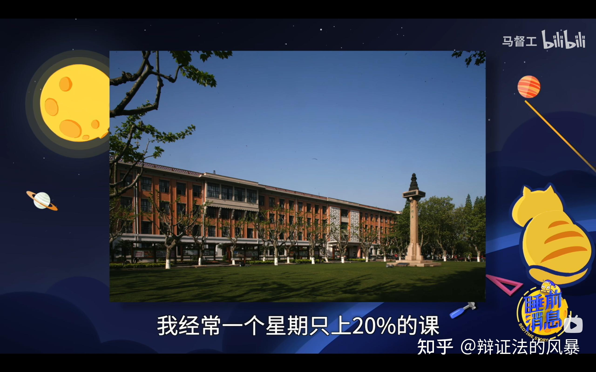

现在是露头就秒

* 同济是一个**学风严谨**的学校

这个不是开玩笑，作弊被抓到会被直接退学的，学院想保住你也保不住。经常会出现每个专业前几名为了绩点相互举报，偶尔刷新被退学的高手

绩点太垃圾也真的毕业不了：我导师明确和说过，同济真的会让学生拿不到毕业证。大概是10年代左右，他们宿舍网瘾很大，整天沉迷LOL不去上课，理所当然在学院举办的第九艺术大赛中勇夺桂冠。结局就是他们宿舍连同隔壁寝室的几个好基友，总计12人左右吧，只有一半的人拿到了毕业证，其他人的是肄业证，甚至极个别人退学了，不过去高考还是去读社会大学就不清楚了[3]

正面来说，只要学习优异，个别鸡毛蒜皮的事情也算不得什么，去年同济一位学长在夏令营直播起飞了以后，照样还是拿到了保研名额

有很多好玩的课程，比如性与健康，玉石鉴赏之类的。不过有人懂全英教学的痛苦吗。。。。[4]

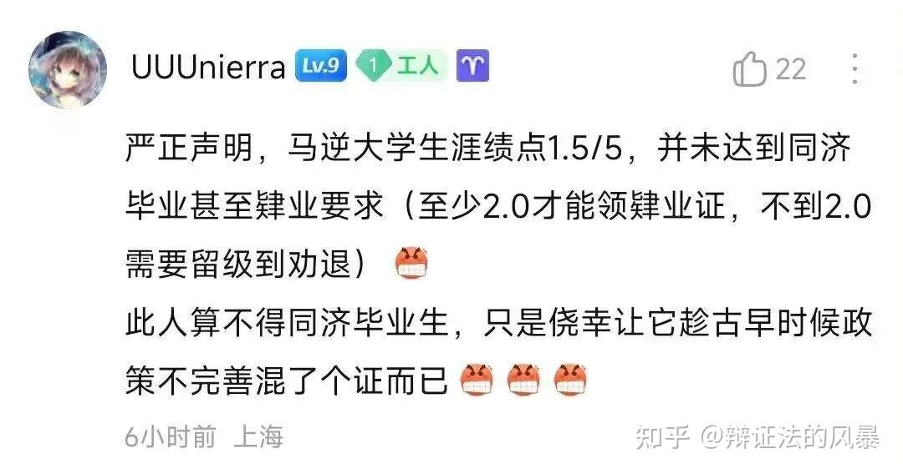

也是给督工遇上好时代了

* 同济管理宽松

这个是真的，没有早自习，没有晚自习，想去哪去哪，学校也没有门禁。对外也开放，刷个身份证就能进来，大部分的地方都能参观，有些食堂还支持二维码付款吃饭（很多大学只能支持本校的学生卡）。还有相当宽松的校园跑，可以多人一齐接力或者直接在场馆挂机

你可以晚上10点出门去某个校级组织的办公室和同学们玩uno，然后三更半夜在校道上遇到认识的情侣在悠闲地散步，接着赶往下一趟夜店。没人在意你干什么

* 同济地理位置优异（嘉定校区小伙伴勿喷）

配合上同济的宽松管理真的有无限可能

没来上海之前我都不知道这个世界上竟然还有面包节这东西，还有各种莫名其妙的会展和博物馆。出门就是地铁10号线，坐两站去五角场消费，或者心烦时去外滩看看也可以

---

* 个别事实错误（督工也许是处于太感激同济的心态？感觉记忆错乱了）以及同济西南八现状

督工住在西南八313

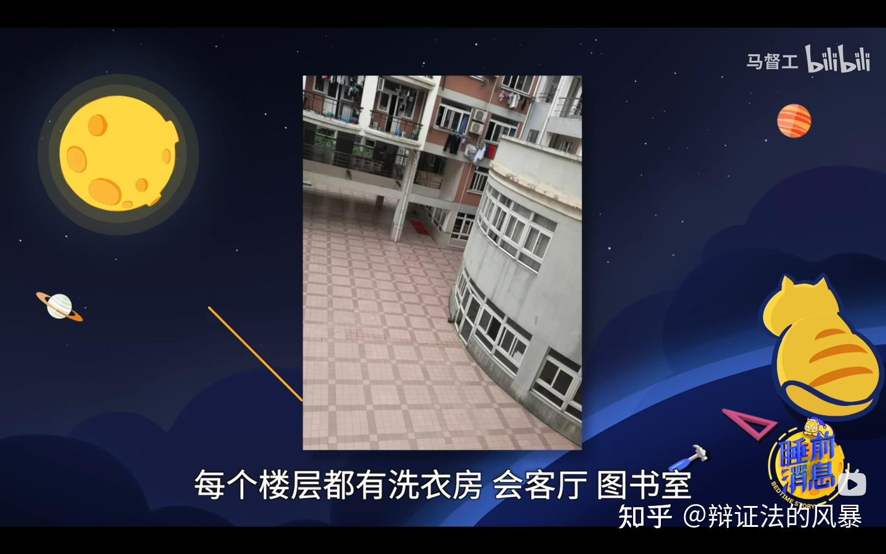

真每层都有就好了

当时看的时候一眼顶针，鉴定为吹牛逼。为了求证这一点，我还特意去问了宿管阿姨[5]

> ”老师你好，我想问几个问题“  
> ”好的哦，同学“  
> ”我看到一位十几年前住在西南八学长说，我们西南八之前还有会客厅，洗衣房，图书室。这个是真的吗？“  
> ”我们每一层都配备有洗衣房呀[6]，这个你应该是知道的。不过我们**只有二楼**有党建室和自习室。你说的图书室从来就没有过，图书室这个要放这么多书籍的地方西南八怎么会放得下呢？“  
> ”意思是说我们之前会客厅改造了吗？“  
> ”对的，现在党建室就是之前的会客厅，现在主要是来举办活动和开会用的[7]。只有二楼有自习室，给同学们看书用的“  
> ”好的，谢谢老师“

我猜是因为督工住在3楼，离2楼的会客厅很近，可能是记错了吧。以2楼的会客厅为基准，1楼对应的位置是公共健身房，3楼是一个大平台[8]

现在西南八是同济住宿最差的宿舍[9]，上下铺，要去1楼洗大澡堂，上世纪的家具，手冲厕所[10]，有个只能接冷水的高位管道[11]，下水道还天天堵塞

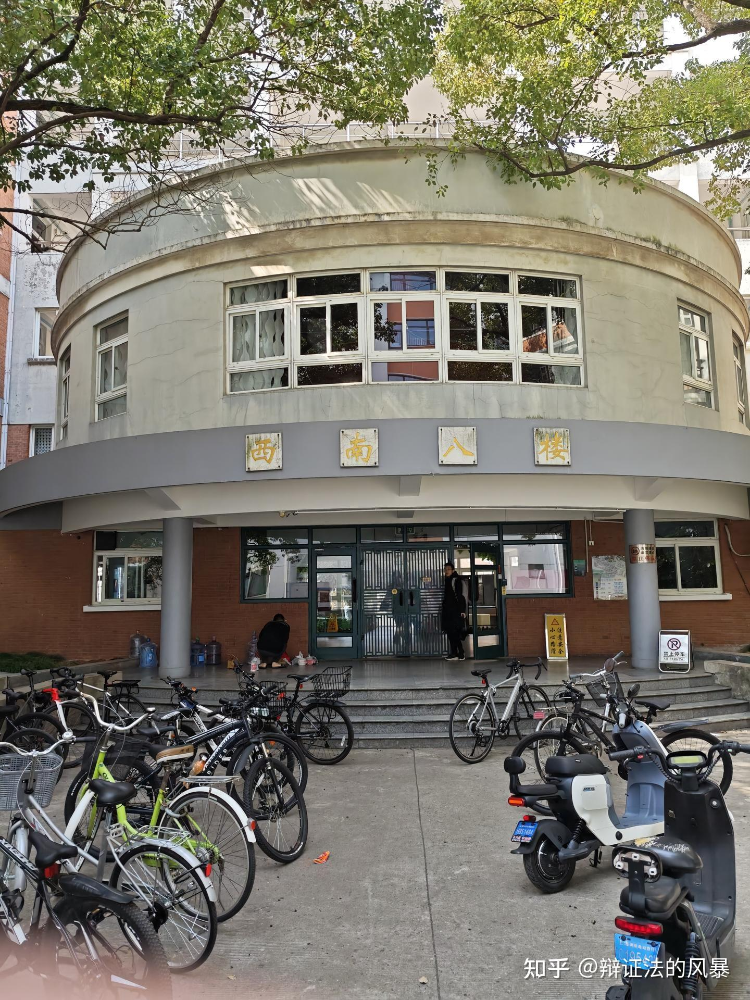

督工的梦中情舍

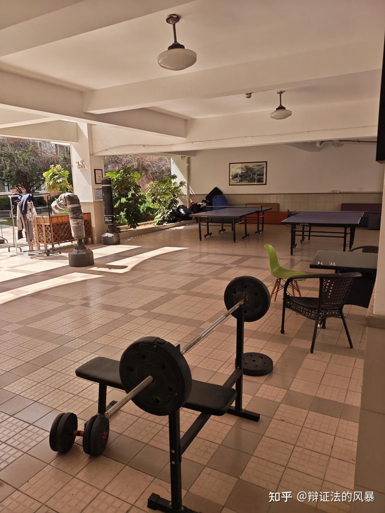

西南八一楼的健身房

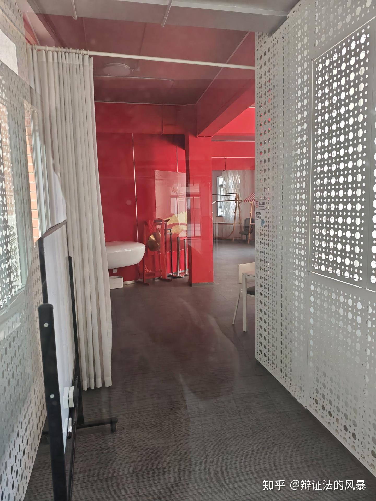

西南八2楼党建室，原会客厅

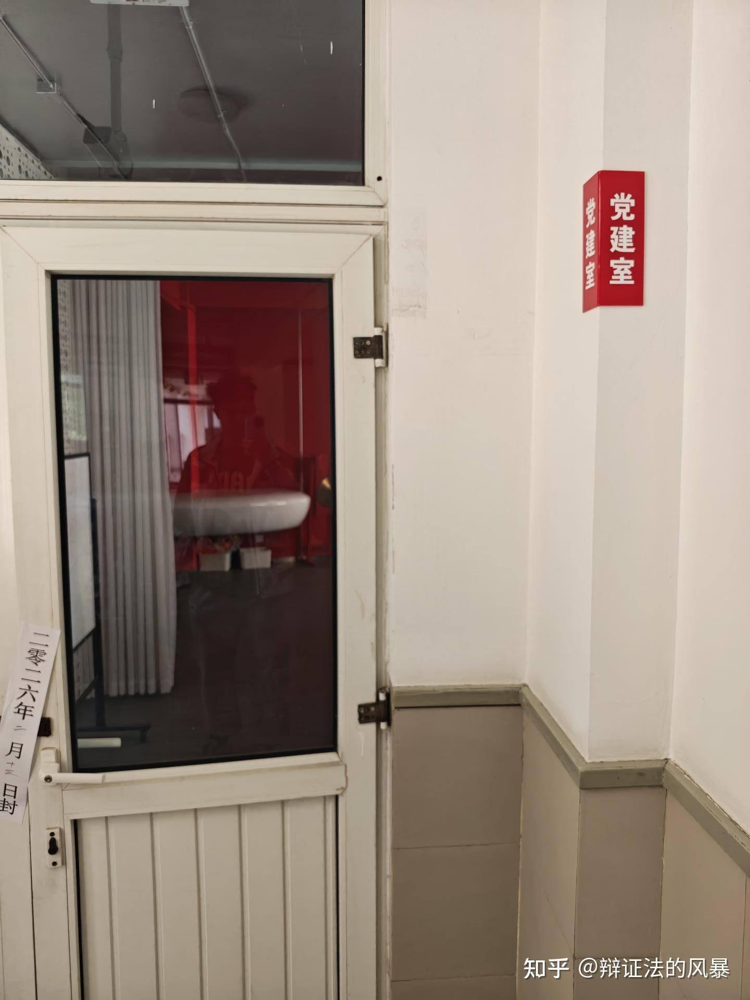

西南八2楼党建室，原会客厅

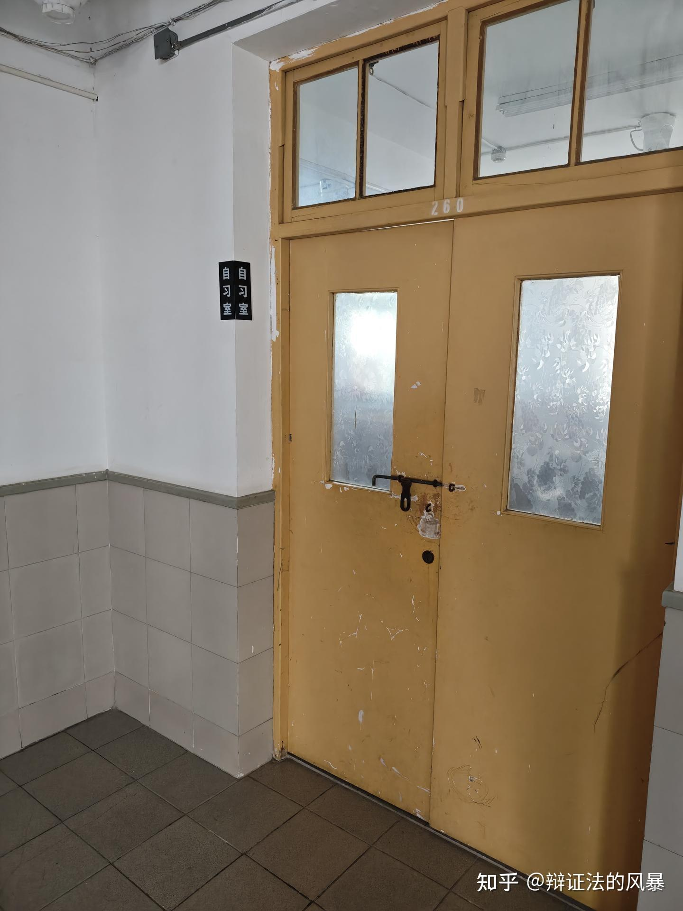

西南八2楼自习室，原”图书室“。一股上世纪的感觉

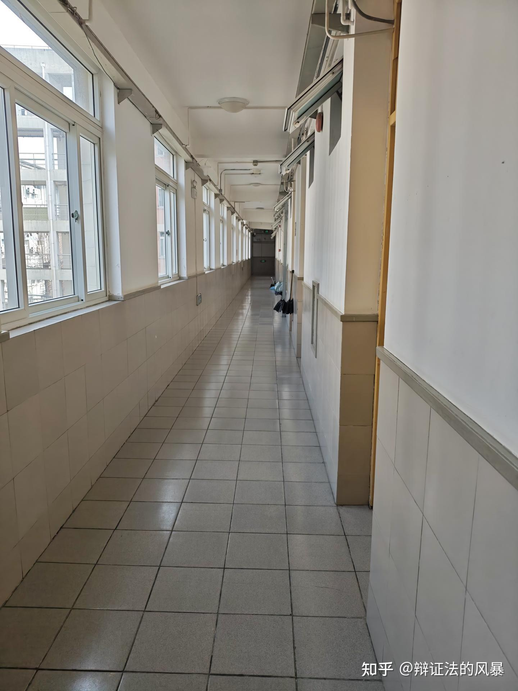

挺整洁一走道

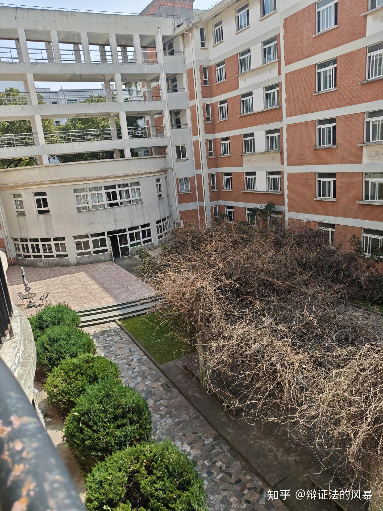

我从阳台拍的照片。从图片上就可以看出来有个圆柱型建筑，那个就是党建室。也从侧面看出来，党建室上空就是平台和楼梯了。并不存在什么”每层“的会客厅

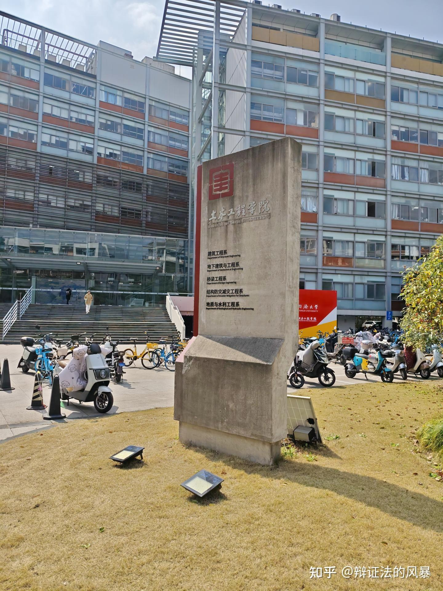

西南八出门右转就是世界第一土木大楼

---

* 让我总结在同济就读的体验，就是上了一个比较轻松的班，按时完成任务，爱咋地咋地，探索自己，探索世界

话说明年校庆，督工要不要回母校宣讲？想听个督工的讲座

有可能的话，欢迎大家报考同济大学和来同济大学参观

---

原文链接：[查看知乎原文](https://www.zhihu.com/question/2013373907667813955/answer/2013643338411181703)
