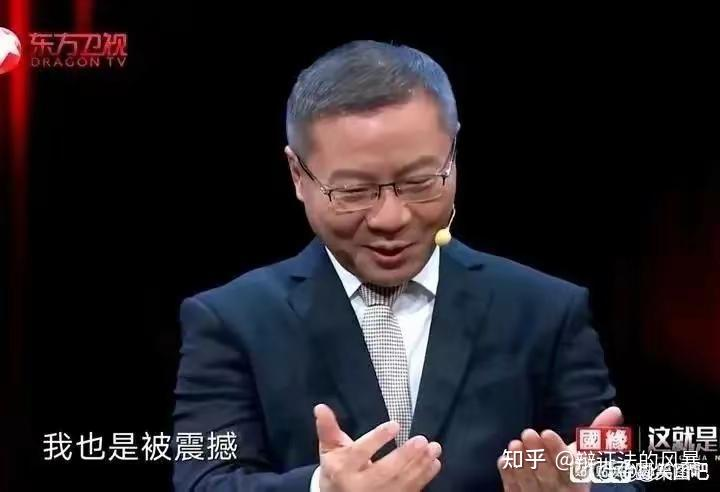

已知“你凭良心说，你的工作够不够500？”，豆包p图收据造假，两次转专业，入党积极分子，储才计划，还有神人副院长“她得处分对你有什么好处？”（貌似马院背景）等

---

分析：

如果女方没有背景

那真的奇贪无比，90%的回扣谁绷得住，糊弄人都不好好糊弄

医学生转专业二连跳，各种积极分子等头衔，这种钻营规则的能力在普罗大众中也是佼佼者

以上这两点明显像是在左右脑互博。要不然太有节目效果了

并且性别反转一下

如果一个男生对出大力的女生说“你的工作500够不够？”，并且伪造收据

还有副院长会提他说话吗？这个3月份的事情用得着5月份才发酵吗？用得着舆论治校吗？会不会触犯校规中3000以上金额的条例，喜提留校察看的处分呢？知乎上讨论他的话题，还会不会荒原呢

估计早就晋升牢字辈，钉在小红书耻辱柱了

---

如果女方有背景，那就很合理了

她的潜台词是，没有我，这个奖根本不会评上

一切的傲慢与高配得感，理所当然

那确实拿4500也是有理有据

就是男主全程陪跑有点难绷

但是有的人说，这样的人进了体制还得了？

**大家都是第一天当中国人吗？**

---

原文链接：[查看知乎原文](https://www.zhihu.com/question/2038798704912639904/answer/2040003716208714820)
