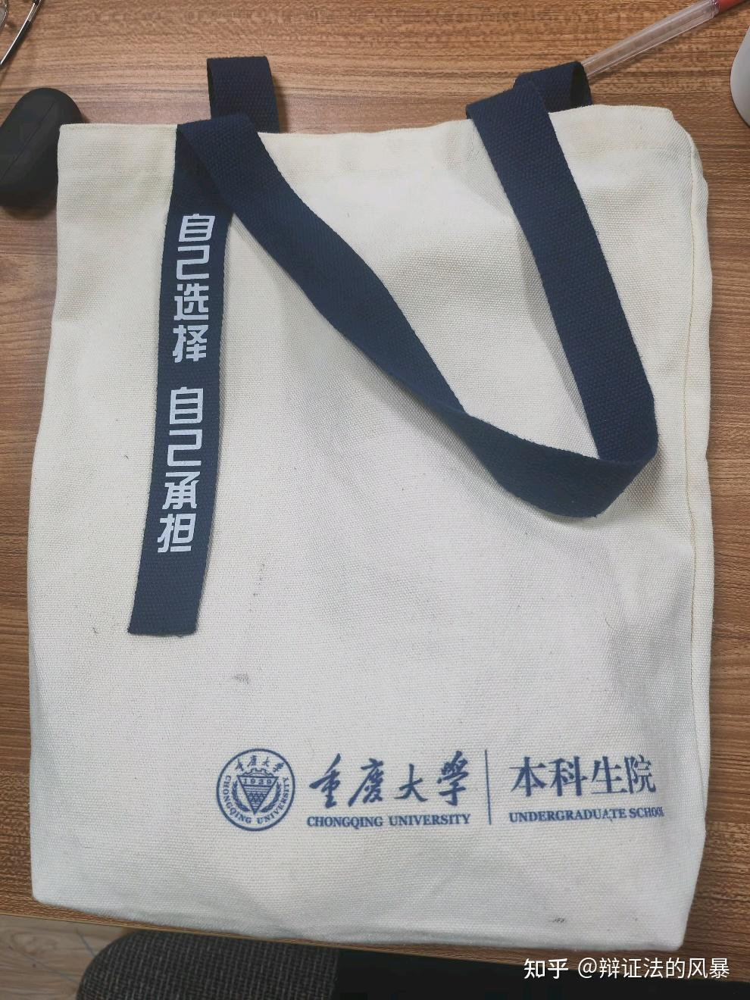

首先，谢谢你钦定我这种人的思想是最自由开放的🤣虽然和我观察到的并不符合

**社会存在决定社会意识**

移动互联网普及以来，体面人所构建的神圣圈层，被短视频和帖子狠狠冲烂，大家的思想水平其实大差不差

不能指望一个只靠刷抖音b站小红书来感知世界的人，思想能有多前卫

回来大学生自身定位

应该没几个人会觉得大学扩招，实际上成为就业市场的蓄水池和广大家长托管的自留地以后，大学生的意见很重要吧？应该没有吧。。。

真把千禧年以前大学生的超国民待遇当做天经地义，理所当然的了吗？真把自己当大院子弟了？

口罩三年期间，武汉那边想征用宿舍，撵走学生，轻而易举。可见地位并没有那么高

学校一刀切懒政，大学生却只骂社会人士，也是让我绷不住

学校要求刷个身份证，不该进的地方设个门禁，关键几个饭堂要搭伙费很难？

是因为前者可以捂嘴开处分，后者拿捏不了大学生所以天天喷是吗？

---

一说纳税人我就想笑

大学生每年是不是要吃补贴？和欧美比学费试试呢？嘲讽工资我更是想笑，要不要比就业率？

大可以在小红书和抖音上发文黑屁广大人民群众的素质有多么低下，猥琐下流

那我只能祈祷你出社会以后，再遇到这些人以后不要太跳脚。特别是让这些人知道你对他们的看法以后

毕竟迟早要面对的

自己受委屈了也别上网求助了，学校内网自己消化一下就够了。外边的大家伙也不配说一嘴

玩不起？呼唤铁拳大手

**“早该管管了”**

那能管的就不止外人了

跑操，晚自习，月考，宵禁，外卖电驴禁令，断水断电等

该不会真的以为学校是站在自己这一边的吧

送一句985名牌大学的本科生院院训

---

原文链接：[查看知乎原文](https://www.zhihu.com/question/2037045537761907885/answer/2040048045350442675)
