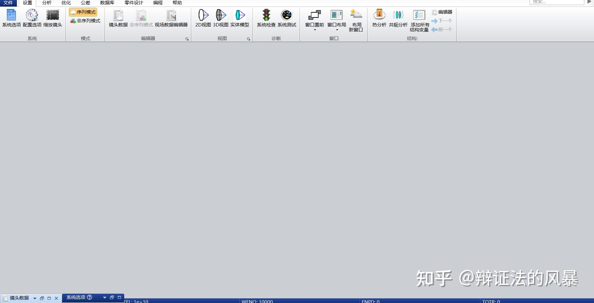
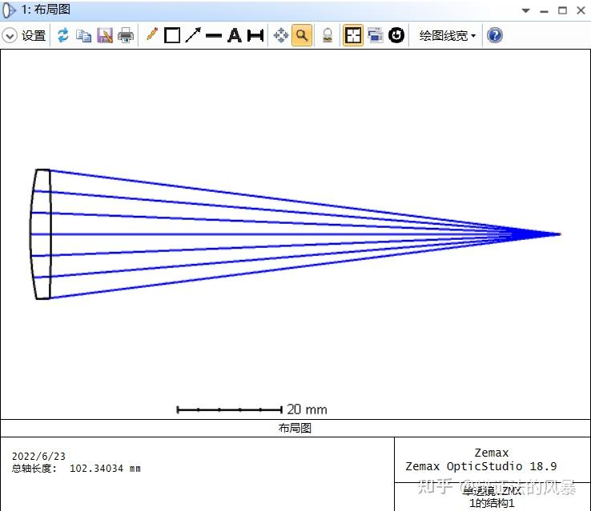
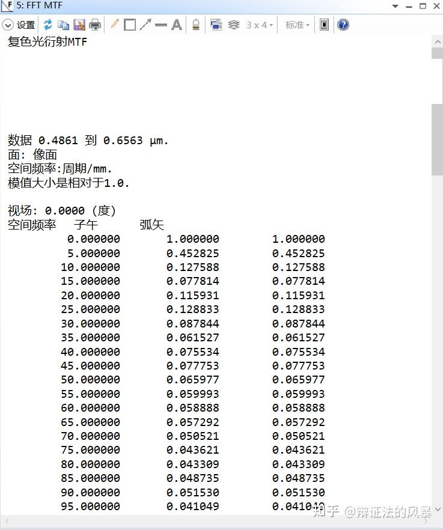
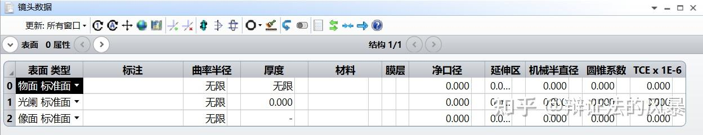
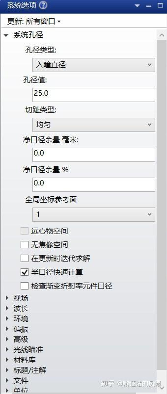
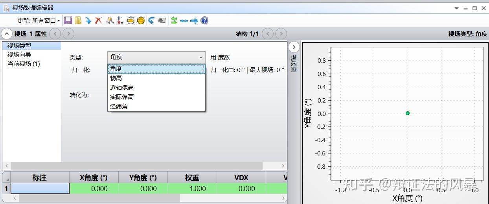
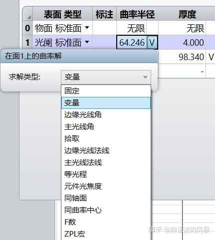
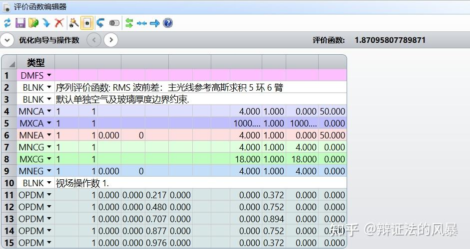
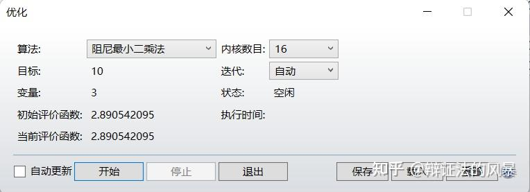

这是”Zemax 入门”系列的上篇： **本篇讲软件基础**——Zemax 是什么、界面怎么看、镜头数据怎么读、孔径/视场/波长怎么设、优化怎么理解、像质怎么评价。 **下篇**将带你完整做一个真实项目——三组态变焦镜头，从打开软件一直走到像质分析。 两篇既适合连读，也可以各自独立阅读。

---

### 第 0 章 写在前面

**这份教程写给谁？** 第一次接触光学设计软件的同学。不需要任何 Zemax 基础，只要对焦距、孔径、像差这些光学名词有印象就够了。

**怎么用这份教程？**

* **通读一遍**（约半小时）：建立对 Zemax 设计流程的整体认识；
* **做作业时回查**：下篇是按真实项目写的操作手册，每一步都可以照着做。
* **善用AI和搜索引擎，视频平台**：你可能会遇到不懂得概念，可以去这些地方寻求帮助，例如：deepseek、b站等。

**版本约定** 本教程以 **Zemax OpticStudio 19.4 中文界面**为准。其他版本（18.9、2024 等）的菜单名称与位置可能略有差异，但核心概念和操作流程完全一致。

**体例说明**

* **加粗**文字表示界面上你要找的菜单/按钮，例如：**设置 → 系统**；
* 「检查点」＝ 做完这一步，你的屏幕上应该看到什么。用它确认自己没做错；
* 引用块是提示（`>`），带 ⚠️ 的是避坑tips。

---

## 第一篇 Zemax 基础

### 1. Zemax 是什么

Zemax（现名 Ansys Zemax OpticStudio）是一个用来**模拟、分析和辅助设计光学系统**的软件。你在软件里搭出一个”虚拟镜头”，它通过光线追迹计算出这个镜头会把光汇聚成什么样子，并帮助你一步步把镜头改好。

先记住两个重要认知：

* 它是**设计工具和助手**，不是”自动驾驶”，更不是现在流行的agent。它不会替你思考，更不能一键设计出一个镜头——设计目标、初始结构、优化方向，都要由自己来定。
* 它的强项：快速追迹光线、给出各种像质评价图、按照你设定的目标自动迭代优化。

**两种工作模式**（先知道区别即可）：

|  | 序列模式（Sequential） | 非序列模式（Non-Sequential） |
| --- | --- | --- |
| 建模对象 | 面（surface） | 物体（object） |
| 光线与面的相交顺序 | 固定，按你排列面的顺序 | 不限制 |
| 光线与同一面相交 | 只相交一次 | 可以多次相交 |
| 分光 / 漫反射 / 全反射 | 不支持 | 支持 |
| 优化与公差分析 | 支持 | 不支持 |
| 典型用途 | 常规镜头设计（本教程全部内容） | 照明系统、杂散光分析等 |

> 记住一句话：**做镜头设计用序列模式**。

本教程从头到尾都在序列模式中操作。

### 2. 界面构成

打开软件，先认识四个关键区域。

**① 主视窗**：标题栏（显示当前文件名）、菜单栏（文件、设置、分析、优化……）、工具栏、状态栏。注意**状态栏**（屏幕最底部）——它会实时显示 EFFL（有效焦距）、ENPD（入瞳直径）等关键参数，做设计时要养成看它的习惯。

*图 2-1 主视窗：顶部是菜单与工具栏，底部状态栏实时显示关键参数*

**② 编辑视窗（Editor Window）**：你大部分时间都在这里工作。常用的有三种：

* **镜头数据编辑器**（Lens Data Editor，LDE）：镜头的”参数表”，最重要；
* **评价函数编辑器**（Merit Function Editor，MFE）：定义”什么样的结果算好”；
* **多重结构编辑器**（Multi-Configuration Editor，MCE）：一个文件装多个状态（做变焦时用）。

（另有公差数据、附加数据、非序列元件编辑器，用到再看。）

**③ 图形视窗（Graphic Window）**：所有画出来的图。最常用的有布局图（Layout）、光线光扇图（Ray Fan）、点列图（Spot Diagram）、MTF 图等。

*图 2-2 图形视窗示例：布局图（Layout），可以看到镜头的形状和光线走向*

**④ 文本视窗（Text Window）**：把数据以文字列表的形式显示出来，例如光扇图背后逐条光线的数值。

*图 2-3 文本视窗示例：同一份数据既能画成图，也能列成表*

此外还有**对话框（Dialogs）**：调参数时弹出的固定小窗口（如视场设置、波长设置），用完点确定或取消即可。

### 3. 序列模式与镜头数据编辑器

**镜头数据编辑器（LDE）是 Zemax 的心脏**，一定要看懂它。

*图 3-1 镜头数据编辑器：一个只填了物面、光阑、像面的”空”系统*

每一行是一个**面（Surface）**，从上到下排列：

| 行 | 名称 | 说明 |
| --- | --- | --- |
| 0 | 物面（OBJ） | 物体在哪里。平行光入射（无穷远物体）填”无限” |
| … | 各透镜表面 | 每片透镜的前表面、后表面各占一行；胶合透镜多一个胶合面 |
| — | 光阑（STO） | 孔径光阑所在的面，决定系统的进光量 |
| … | … | … |
| 最后 | 像面（IMA） | 探测器/成像面 |

**最关键的几列**：

* **曲率半径（Radius）**：面的弯曲程度。正负号表示弯曲方向；平面填”无限”。
* **厚度（Thickness）**：⚠️ 最容易理解错的一列。它表示**“从这个面到下一个面的距离”**，不是某片透镜的厚度。两个玻璃面之间的厚度是玻璃厚度；一个玻璃面到下一个透镜之间的厚度就是**空气间隔**。
* **材料（Glass）**：这个面之后、下一个面之前填充的介质，例如 BK7、F2；是空气就留空。
* **净口径（Semi-Diameter）**：这一面的通光半径。

> 记忆技巧：**厚度属于”面与面之间”，不属于某一片透镜**。

后面做变焦镜头时，我们改的就是几个空气间隔的厚度。

**面的位置规则**：每个面的位置由前一面加上前一面的厚度决定，因此改任何一个厚度都会牵一发而动全身。

### 4. 系统三件套：孔径 / 视场 / 波长

任何光学系统开建之前，先定三件事：**孔径**（进多少光）、**视场**（要看多大范围）、**波长**（用什么颜色的光）。这三项都在 **设置 → 系统** 里设置。

**① 孔径（Aperture）**：决定光束的粗细。

| 类型 | 什么时候用 |
| --- | --- |
| 入瞳直径 | 最常用。直接给出进入系统的平行光束直径 |
| 像空间 F 数 | 已知 F 数时使用（F 数 = 焦距 ÷ 入瞳直径） |
| 物方空间数值孔径 | 显微、投影等有限共轭系统 |
| 光阑尺寸浮动 | 光阑大小固定、需要反过来推算入瞳时 |

*图 4-1 孔径类型：常见系统选”入瞳直径”即可*

**② 视场（Field）**：决定设计要覆盖多大范围。类型有四种（角度 / 物高 / 近轴像高 / 实际像高），区别只是”离轴多远”用什么单位来描述：

* 无穷远物体（平行光入射）→ 常用**角度**：填主光线与光轴的夹角；
* 有限远物体 → 常用**物高**：填物体的尺寸。

填法约定：一般只在 **y 方向**填值，x 方向填 0；轴上视场填 0。例如要覆盖三个视场，就填三行：y = 0、6、9。

*图 4-2 视场数据设置：每个视场一行，可分别设权重*

**③ 波长（Wavelength）**：用什么光做设计。可见光系统常用 F、d、C 三条谱线：

| 谱线 | 波长 | 说明 |
| --- | --- | --- |
| F 光 | 0.486 μm | 蓝光 |
| d 光 | 0.588 μm | 黄光，人眼最敏感，通常设为主波长 |
| C 光 | 0.656 μm | 红光 |

> 为什么用 F、d、C 三条线？F 光和 C 光在透镜里的折射率差异最大，用它们”一蓝一红”来控制和校正**色差**；中间的 d 光代表主要成像波长。三条线一起优化，是可见光镜头最经典的做法。

### 5. 优化入门

Zemax 的优化可以总结成一句话：**告诉软件哪些参数能动（变量）、什么样的结果算好（评价函数），它自动调整。**

流程四步：

1. **设变量**：在镜头数据编辑器里，把要参与自动调整的参数（比如某个曲率半径）的求解类型设为”变量”；
2. **写评价函数**：在评价函数编辑器里逐条输入**操作数（Operand）**——比如”EFFL（有效焦距）= 100，权重 1”，就是告诉软件”我希望焦距是 100 mm，而且这件事很重要”；
3. **选算法**：打开 **优化 → 优化**，选优化算法（常用”阻尼最小二乘法”）和迭代次数，点”开始”；
4. **评结果**：观察评价函数值是否下降、点列图/MTF 是否改善。不满意就调整变量和目标，再来一轮。

*图 5-1 把参数的求解类型设为”变量”：点击单元格下拉，选择”变量”*

*图 5-2 评价函数编辑器：每行一条操作数，包含类型、目标值、权重*

**操作数三要素**：类型（Type，算什么）、目标（Target，希望它等于多少）、权重（Weight，有多重要）。权重越大，优化时越优先满足这一条。

常用操作数分四类（完整速查见附录 A）：

* **像差类**：SPHA（球差）、COMA（彗差）、ASTI（像散）、FCUR（场曲）、DIST（畸变）；
* **MTF 类**：MTFT（子午方向传函）、MTFS（弧矢方向传函）、MTFA（平均值）；
* **基本光学特性**：EFFL（有效焦距）、PMAG（近轴放大率）、ISFN（像方 F 数）等；
* **边界约束**：CTGT / CTLT（中心厚度大于 / 小于）、TOTR（总长）等——防止优化出”物理上做不到”的结果。

*图 5-3 优化对话框：选算法与迭代次数*

> ⚠️ **不要一次把所有参数都设成变量**。变量越多，解空间越大，越容易”优化”出一堆数值上好看、物理上奇怪的结果。 而且评价函数编辑器是优化到一个函数得局部最优解，所以一下子加入太多参数可能卡死在某个你不想要看到得结构上。 正确节奏是**一步一步来**：先放几个最关键的参数，收敛了再加下一批（这条经验在下篇会反复用到）。

### 6. 像质评价工具箱

优化完，怎么判断结果好不好？认识四个最常用的图：

**① 点列图（Spot Diagram）**——一个物点发出的光，经过镜头后在像面上聚成多大一个斑。

* 关键数字：**RMS 半径**（光斑能量集中程度，越小越好）、**GEO 半径**（光斑最大几何范围）、**艾里斑半径**（衍射极限的参照）。
* 判断：RMS 半径越小越好；如果 RMS 已经接近甚至小于艾里斑半径，说明逼近了衍射极限。

**② MTF 图**——描述系统在不同空间频率下还能保留多少对比度。

* 判断：实际曲线越接近最上方的衍射极限曲线越好；子午（T）与弧矢（S）曲线越靠拢越好（分开说明有像散）。

**③ 场曲 / 畸变图**——左图看像面弯不弯（T、S 曲线越平、越贴近零位越好）；右图看几何变形程度（畸变百分比，一般控制在百分之几以内）。

**④ 光线光扇图（Ray Fan）**——每条光线的落点偏差随孔径位置变化的曲线。

* 判断：曲线越平直、越贴近横轴，像差越小；曲线两端翘起，说明边缘光线有高阶像差。

光看这些定义还不够——**下篇第 12 章**会对着真实项目的结果图，把每张图再讲一遍。

---

## 附录

### 附录 A 常用操作数速查表

| 分类 | 操作数 | 作用 |
| --- | --- | --- |
| 像差 | SPHA | 球差 |
|  | COMA | 彗差 |
|  | ASTI | 像散 |
|  | FCUR | 场曲 |
|  | DIST | 畸变 |
| MTF | MTFT | 子午方向调制传递函数 |
|  | MTFS | 弧矢方向调制传递函数 |
|  | MTFA | 平均调制传递函数 |
| 基本光学特性 | EFFL | 有效焦距 |
|  | PMAG | 近轴放大率 |
|  | AMAG | 角放大率 |
|  | EXPP | 出瞳距离 |
|  | ISFN | 像方 F 数 |
| 边界约束 | CTGT / CTLT | 中心厚度 大于 / 小于 |
|  | ETGT / ETLT | 边缘厚度 大于 / 小于 |
|  | TOTR | 第一面到像面的总长 |
|  | OPLT / OPGT | “小于 / 大于”约束（配合其他操作数使用） |
| 基本计算 | ABSO | 绝对值 |
|  | ASIN、COSI | 反正弦 / 余弦 |

### 附录 B 参考资料

* Zemax 操作数手册（软件自带帮助 / 在线文档）
* 李晓彤, 岑兆丰. 几何光学·像差·光学设计. 浙江大学出版社.
* 变焦与无焦系统基础及操作参考：

+ <https://www.optkt.com/fa/356/1>
+ <https://en.wikipedia.org/wiki/Beam_expander>
+ <https://en.wikipedia.org/wiki/Afocal_system>

---

**下篇预告**：《Zemax 入门教程（下）：实战篇——三组态变焦镜头》。用一个真实项目把本篇的知识全部串起来：从软件自带镜头库出发，设置多重结构，写评价函数，迭代优化出 30 / 60 / 90 mm 三个焦段，并逐张解读像质分析图。

---

原文链接：[查看知乎原文](https://zhuanlan.zhihu.com/p/2089726674011215411)
