这是”Zemax 入门”系列的下篇：用一个真实项目，把上篇的知识全部串起来——**设计一个 30 / 60 / 90 mm 三组态变焦镜头**：从打开软件自带的样例镜头开始，设置多重结构、写评价函数、迭代优化，一路做到像质分析。

> 前置说明：本篇假设你已读过上篇（软件基础）。版本以 **Zemax OpticStudio 19.4 中文界面**为准，截图取自课程教学资料。

---

本项目要把 Zemax 自带的一个样例镜头，改造成**短焦 30 mm / 中焦 60 mm / 长焦 90 mm 三个状态**的变焦镜头，并完成像质分析。建议打开软件跟着做。

### 7. 项目要求解读

**任务**：设计三组态变焦镜头，指标如下。

| 项目 | 要求 |
| --- | --- |
| 结构形式 | 三组态变焦镜头（短焦、中焦、长焦三个状态） |
| 焦距 | 30 / 60 / 90 mm（变焦比 3×） |
| 入瞳直径 | 12 mm（因此 F 数 = 焦距 ÷ 12，三个组态分别为 F/2.5、F/5.0、F/7.5） |
| 波长 | F、d、C 光三条，d 光为主波长 |
| 视场 | 像面半视场 0 / 6 / 9 mm（y 方向） |
| 后工作距 | ≥ 25 mm（给探测器/机械结构留安装空间） |
| 机械总长 | 第一面到像面 ≤ 150 mm |
| 厚度约束 | 玻璃中心厚度与边缘厚度 ≥ 3 mm；空气间隔 ≥ 1 mm |
| 评价指标 | RMS 点列半径，目标 < 2×艾里半径 |

**先搞懂变焦原理**。镜头的焦距由镜片之间的空气间隔决定——**改空气间隔，焦距就变**。像高 y′、焦距 f′、视场角 θ 之间有一个基本关系：

> y′ = f′ · tanθ

探测器（像面）的尺寸是固定的，所以焦距一变，能拍到的视场范围也跟着变——这就是”变焦”。

典型的变焦系统由四部分构成（从物方到像方）：

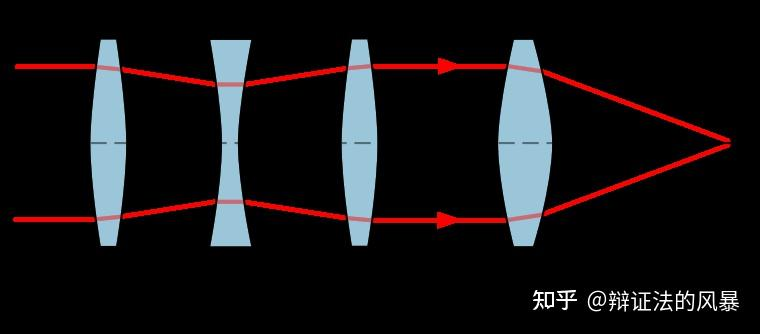

*图 7-1 典型变焦系统的组元构成*

* **前固定组**：不动，负责初步会聚光线；
* **变倍组**：沿光轴移动，改变系统焦距（移动量最大的一组）；
* **补偿组**：沿光轴移动，把像面”拉回”固定位置，保证整个变焦过程中成像始终落在探测器上；
* **后固定组**：不动，最终成像并校正残余像差。

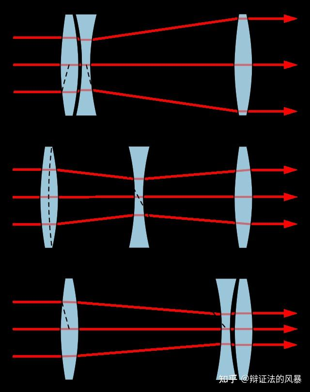

*图 7-2 变焦过程：两组联动移动，焦距连续变化而像面保持不动*

### 8. 输入初始结构

**初始结构从哪里来？** 从 Zemax **软件自带的镜头库**里拿——不需要从零算起。路径是：

> 文档 → Zemax → Samples → Short course → Archive → **sc\_zoom1.zmx**

（也可以直接 **文件 → 打开**，定位到 Zemax 安装后生成的 Samples 文件夹。）这是一个经典的**三片式（3 组双胶合）变焦结构**，正好拿来当初始结构进行设计。

**操作步骤**：

1. 打开自带样例 `sc_zoom1.zmx`。注意：样例的入瞳直径是 25 mm，与作业要求不符，要改；
2. 按课程要求另存为自己的文件（文件名建议按课程规范命名，后面所有操作都在自己的文件里进行，也方便进行版本控制。记得每次完成一个小流程时，手动另存为到工作文件夹中，以免后续改崩了得从头再来的尴尬情况）；
3. **设置 → 系统**：孔径类型选**入瞳直径**，值改为 **12**；
4. 设置视场：像高类，三行 y = **0、6、9**（x 全为 0）；
5. 设置波长：**0.486、0.588（主波长）、0.656** μm 三条；
6. 打开 **分析 → 布局图 → 3D 布局图**，在设置里把 **Y 偏移**改为 **60 mm**——这样以后三个组态的光路会上下排开，一眼就能对比。

**检查点**：此时镜头数据编辑器应与下图一致；状态栏 EFFL 显示 **98.5577 mm**。

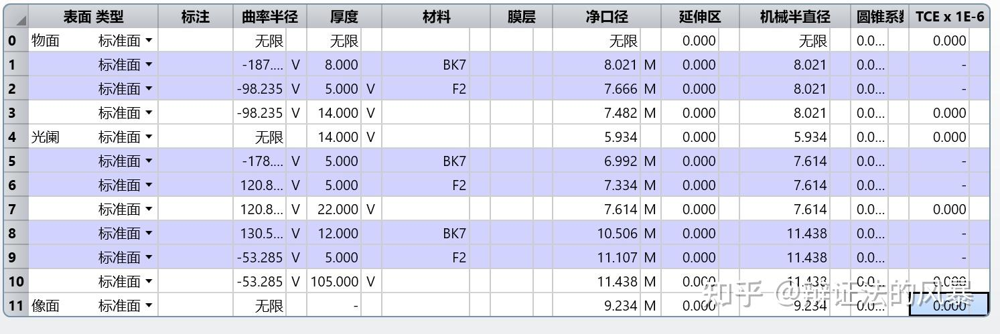

*图 8-1 打开样例并改完入瞳直径后的镜头数据编辑器*

初始结构关键参数（供核对，数值来自自带样例）：

| 面 | 曲率半径 (mm) | 厚度 (mm) | 材料 | 说明 |
| --- | --- | --- | --- | --- |
| 1 | −187.80 | 8.000 | BK7 | 双胶合① 前表面 |
| 2 | −98.235 | 5.000 | F2 | ① 胶合面 |
| 3 | −98.235 | 14.000 | 空气 | ① 后表面 |
| 4 | 无限 | 14.000 | 空气 | 光阑（STO） |
| 5 | −178.90 | 5.000 | BK7 | 双胶合② 前表面 |
| 6 | +120.82 | 5.000 | F2 | ② 胶合面 |
| 7 | +120.82 | 22.000 | 空气 | ② 后表面 |
| 8 | +130.50 | 12.000 | BK7 | 双胶合③ 前表面 |
| 9 | −53.285 | 5.000 | F2 | ③ 胶合面 |
| 10 | −53.285 | 105.000 | 空气 | ③ 后表面（后工作距） |
| 11 | 无限 | — | — | 像面（IMA） |

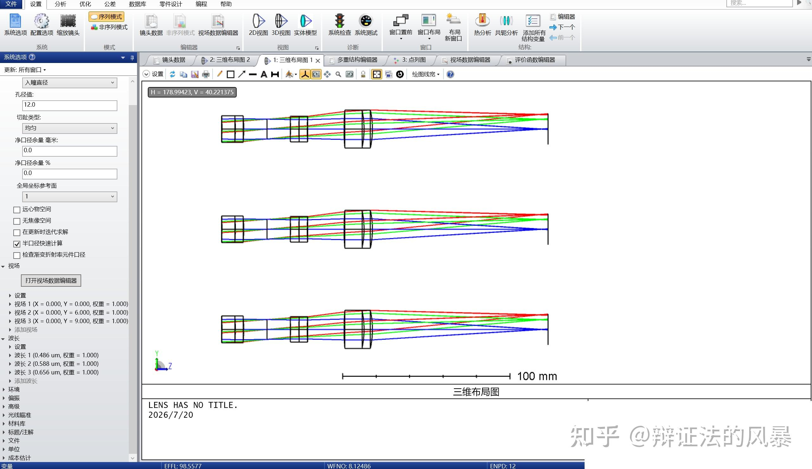

*图 8-2 初始结构的 3D 布局图：三组双胶合透镜，光阑在第一、二组之间*

**发现的问题**：三组态的 EFFL 都是 98.5577 mm——它现在还是个”定焦”镜头！要让它变成 30/60/90 的变焦镜头，必须让某些参数随组态变化。这正是下一步要做的。

### 9. 多重结构编辑器

**为什么需要它**：变焦的本质是”**同一个镜头**在不同状态下有不同的空气间隔”。Zemax 用**多重结构（Multi-Configuration）**来实现：一个文件里放多个组态（Configuration），曲率半径和材料仍然共享，只让指定的量随组态变化。

**操作步骤**：

1. 打开 **设置 → 多重结构编辑器**；
2. 插入 4 个 **THIC**（厚度）操作数，分别对应面 **3、4、7、10**——这四个面的厚度正好是变焦时变化的几段空气间隔：双胶合①→光阑、光阑→双胶合②、②→③、③→像面；
3. 把每个 THIC 的求解类型都设为**变量 V**，让优化时允许它们在不同组态取不同的值；
4. 左上角会显示”活动：1/3”，可在三个组态之间切换查看。

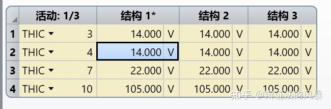

*图 9-1 多重结构编辑器：THIC 操作数分别控制面 3、4、7、10 的厚度*

1. 回到**镜头数据编辑器**，把除物面、光阑、像面以外的**所有曲率半径**求解类型都设成变量（V）。

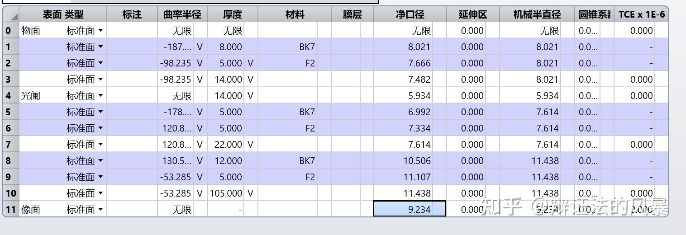

*图 9-2 镜头数据编辑器：所有曲率半径已设为变量*

> 经验：**要几个焦距状态，就设几个组态**；组态里要变的量，全部提取到多重结构编辑器中管理，不要直接在镜头数据编辑器里各改各的。

### 10. 评价函数

现在告诉 Zemax”什么样的结果算好”。

**操作步骤**：

1. 打开 **优化 → 评价函数编辑器**，点**优化向导**，按下图设置：

* 优化函数（Image Quality）：**点列图**；类型：**RMS**；参考：**质心**；
* 光瞳采样：高斯求积，3 环 6 臂（默认值即可）；
* **厚度边界**：勾选**玻璃**和**空气**——玻璃 最小 **3**、最大 **20**；空气 最小 **1**、最大 **100**（对应”玻璃厚度 ≥3 mm、空气间隔 ≥1 mm”的要求）；
* 点**确定**，向导会自动生成一整套边界约束操作数。

1. 为每个组态指定焦距目标：在每个组态下插入一条 **EFFL**——

* 组态 1：EFFL 目标 **30**，权重 1；
* 组态 2：EFFL 目标 **60**，权重 1；
* 组态 3：EFFL 目标 **90**，权重 1。

1. 加总长约束：插入 **TOTR**（第一面到像面的总长），配合 **OPLT**（”小于”约束）使用，控制总长不超过约 **145 mm**（对应要求”总长 ≤150 mm”，这里留一点余量），权重 1。

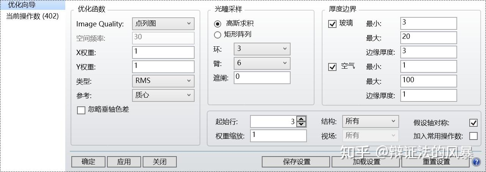

*图 10-1 优化向导：类型选 RMS 点列图，并勾选玻璃/空气的厚度边界*

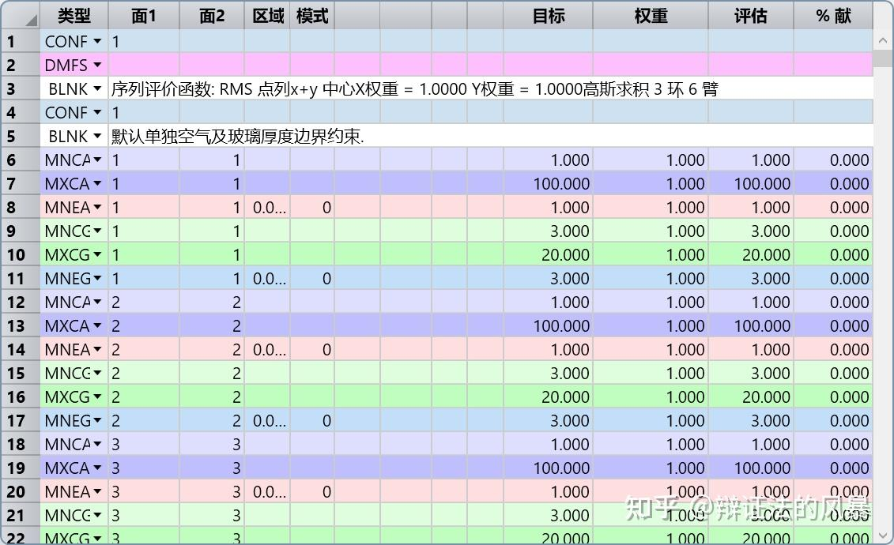

*图 10-2 向导自动生成的初始评价函数：CONF 把操作数分成三个组态，边界操作数（MNCA/MXCA/MNCG/MXCG 等）控制曲率与厚度范围*

**CONF 的作用域**：CONF 操作数管理它**之后**的所有操作数，直到遇到下一个 CONF 为止。所以每个组态的 EFFL 要写在对应 CONF 的后面。

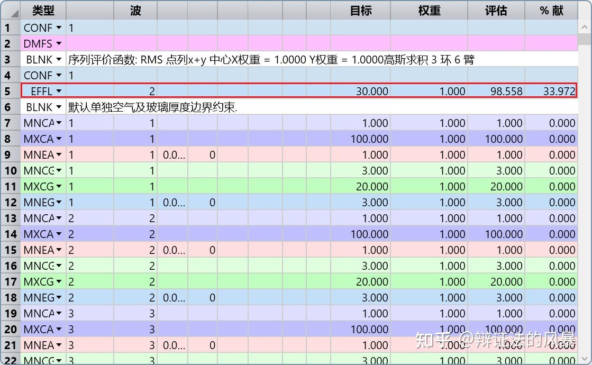

*图 10-3 在组态 1 下插入 EFFL = 30*

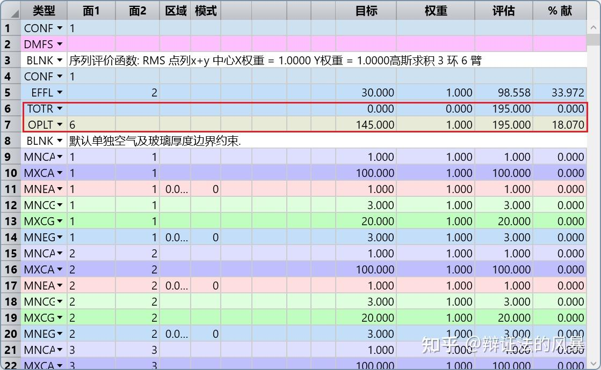

*图 10-4 用 TOTR + OPLT 控制总长*

### 11. 迭代优化

**第一次优化**：打开 **优化 → 优化**（优化对话框），算法选**阻尼最小二乘法**，迭代次数用默认值，点**开始**。观察评价函数值一路下降，直到收敛（数值不再明显变化）。

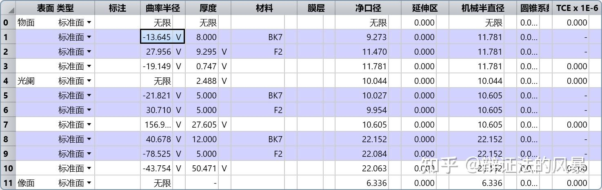

*图 11-1 第一次优化后的镜头参数*

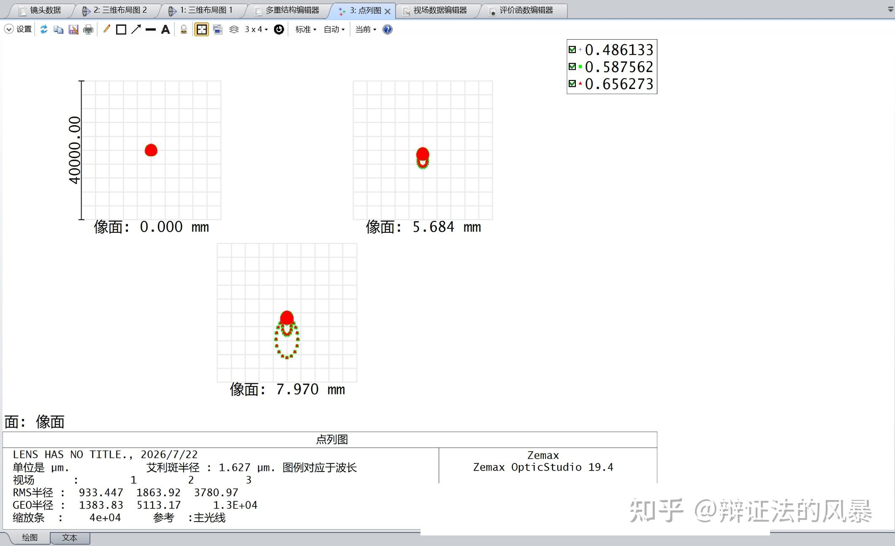

*图 11-2 第一次优化后的点列图：RMS 半径仍在数百 μm 量级（三个视场分别约 933 / 1864 / 3781 μm），离目标还差得远*

别急——第一次优化只是”热身”。先看结果，再发现问题、解决问题。

**发现的问题：口径不统一**。对比三个组态会发现：同一片镜片，在组态 1/2/3 里的”净口径”数值不一样。原因是 Zemax 的元件口径默认**自动跟随光线变化**，每个组态各自算各自的最小口径。但现实中三个状态用的是**同一组镜片**——物理口径必须统一！

**解决**：把（除物面、光阑之外的）所有面的口径求解类型设置为 **Maximum（最大）解**，即取三个组态中的最大值，让每片镜片按”能装下所有组态”的口径工作。

**第二次优化**：设完口径后再次点开始。优化完成后可以发现：RMS 半径相比第一次有改善，但仍然在数百 μm 量级——**离最终目标还差两个数量级**，说明后面还需要继续多轮迭代。

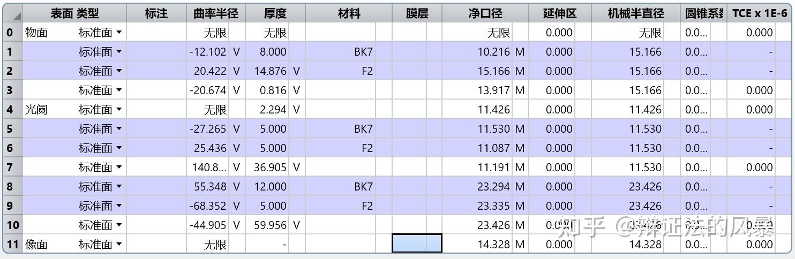

*图 11-3 第二次优化后的镜头参数（口径已统一为 Maximum 解）*

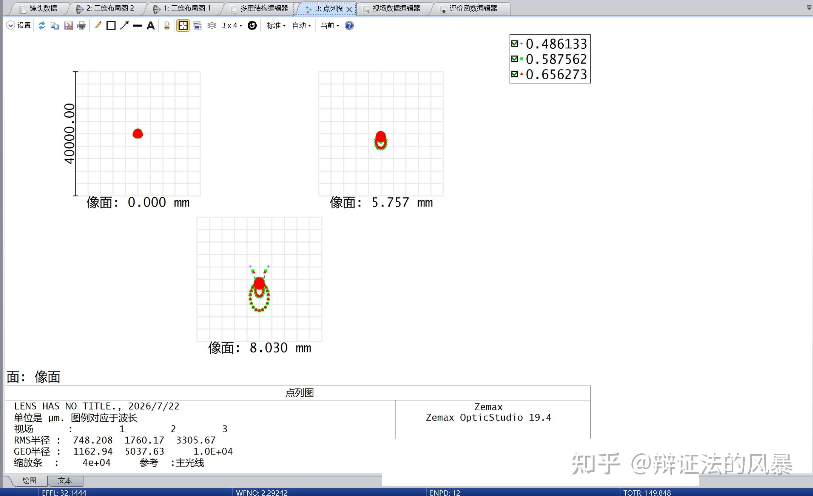

*图 11-4 第二次优化后的点列图：有所改善（三个视场分别约 748 / 1760 / 3306 μm），但仍在数百 μm 量级*

**继续迭代**。之后就进入”加约束 → 优化 → 看图 → 再加约束”的循环，每一轮解决一类问题：

* 核对**后工作距**（像面前一段的厚度）是否 ≥ 25 mm；
* 核对**机械总长**是否 ≤ 150 mm，超了就加大 TOTR 约束的权重；
* 检查**边缘厚度**，太薄的镜片加工困难；
* 每轮优化后都回镜头数据编辑器扫一眼：有没有出现交叠、负厚度之类的异常数值。

> ⚠️ **一步一步优化，不要一次加太多参数**。

经验顺序：先优化像差最敏感的曲率半径 → 再整体优化全部曲率半径 → 然后优化空气间隔 → 再优化透镜厚度 → 最后才考虑更换材料。一轮只动一类，出了问题才好回退。

最终结果：

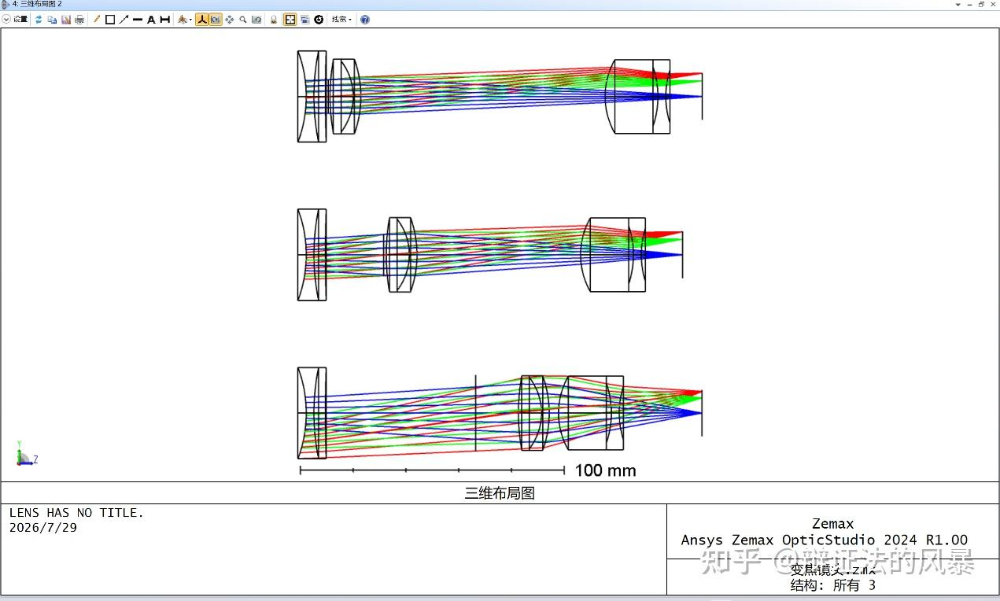

*图 11-5 最终优化后的 3D 布局图：三个组态纵向排开，像面位置基本对齐*

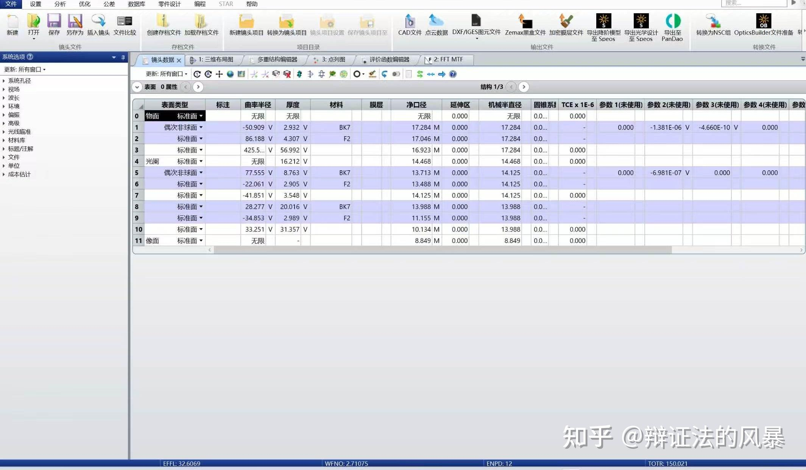

*图 11-6 最终镜头参数：状态栏实时显示当前组态的 EFFL、F 数、入瞳直径与总长*

### 12. 像质分析

终于到了验收时刻：逐个打开分析图，读懂它，并与设计要求对照。这也是对**上篇第 6 章**的”实战复习”。

### 12.1 点列图

三个焦段分别打开 **分析 → 点列图**：

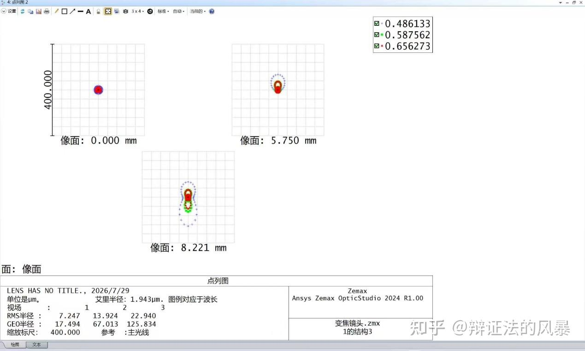

*图 12-1 30 mm 焦段点列图*

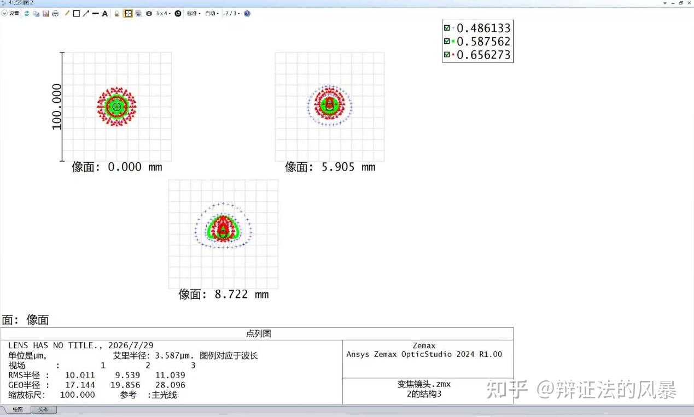

*图 12-2 60 mm 焦段点列图*

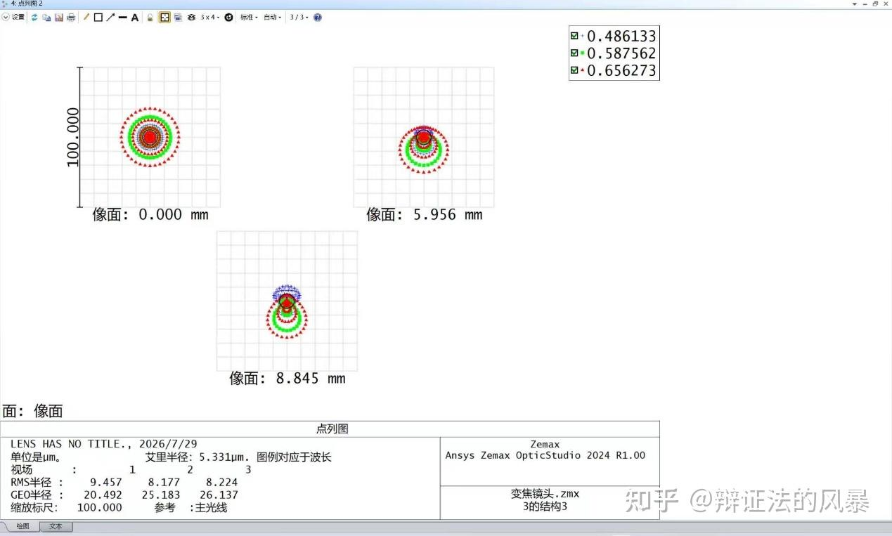

*图 12-3 90 mm 焦段点列图*

**读图**：

* 三焦段 RMS 半径：**7.247 / 10.011 / 9.457 μm**（30 / 60 / 90 mm）→ 光斑都在 10 μm 上下，能量集中度较好；
* GEO 半径：**17.494 / 17.144 / 20.492 μm**，都在 RMS 半径的 2 倍上下 → 无明显离轴拖尾，像差分布均匀；
* 与衍射极限对比：三焦段艾里半径分别为 **1.943 / 3.587 / 5.331 μm**，目标”RMS < 2×艾里”对应 3.886 / 7.174 / 10.662 μm——**30 mm 和 60 mm 未达到**（几何像差仍为主导），**90 mm 达到了**（9.457 < 10.662）。

> 这类三组态、大相对孔径的系统很难在全焦段逼近衍射极限：变焦要求”同一组镜片”兼顾三个状态，优化时无法把每个焦距的像差都压到极致。

### 12.2 MTF 图

**分析 → MTF → FFT MTF**，三个焦段：

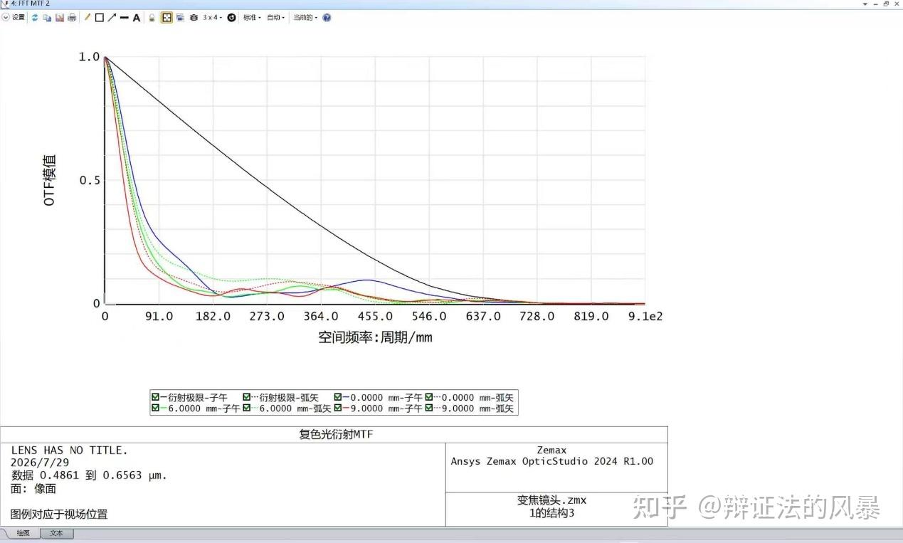

*图 12-4 30 mm 焦段 MTF*

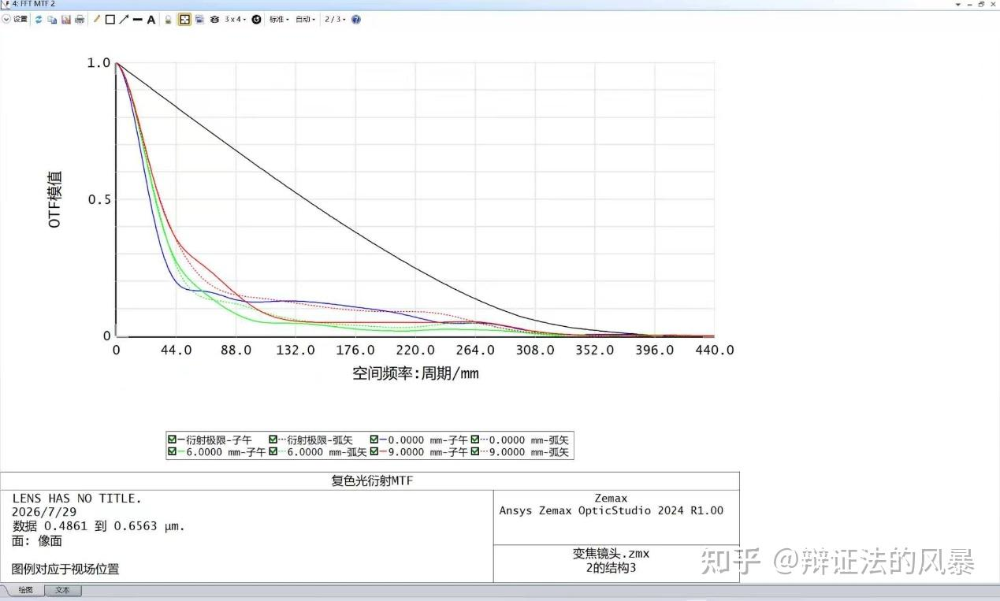

*图 12-5 60 mm 焦段 MTF*

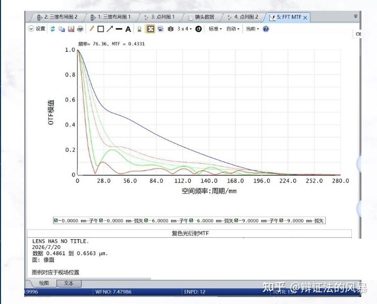

*图 12-6 90 mm 焦段 MTF*

**读图**：

* 三个 F/d/C 波长的曲线彼此靠近 → **色差校正较好**；
* 子午（T）与弧矢（S）曲线分离小 → **像散控制良好**；
* 曲线平滑下降、没有剧烈振荡 → 没有明显的高阶像差主导；
* 曲线整体位于衍射极限下方，还有提升空间，但趋势健康。

### 12.3 场曲 / 畸变图

**分析 → 场曲/畸变**，三个焦段：

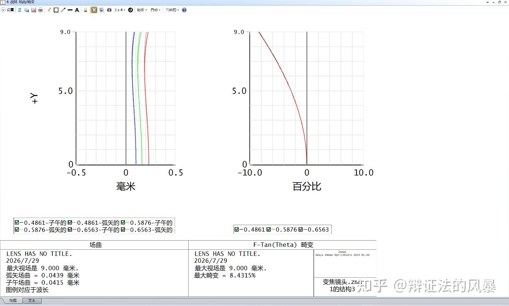

*图 12-7 30 mm 焦段场曲/畸变*

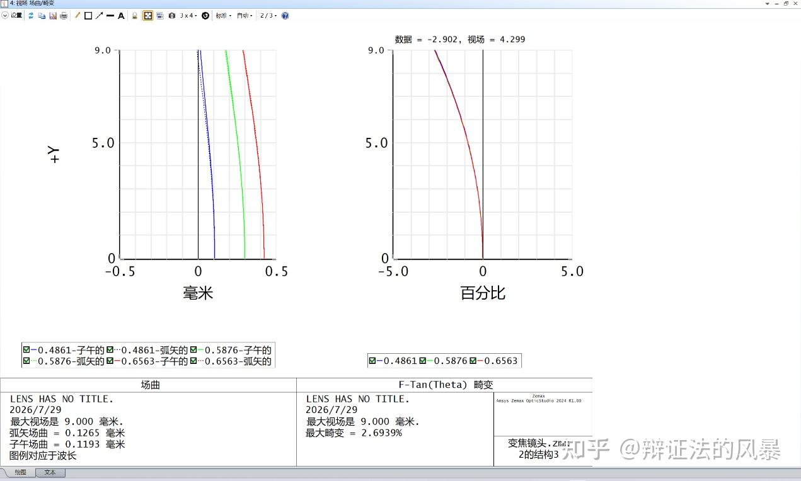

*图 12-8 60 mm 焦段场曲/畸变*

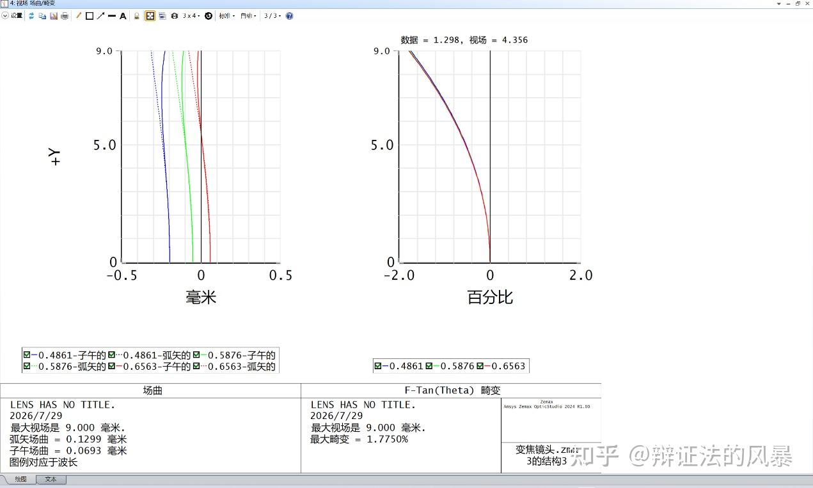

*图 12-9 90 mm 焦段场曲/畸变*

**读图**：

* 场曲：弧矢方向 **0.0439 / 0.1265 / 0.1299 mm**、子午方向 **0.0415 / 0.1193 / 0.0693 mm**，都在 0.13 mm 以内 → 像面较平坦；
* 畸变：**+8.43% / +2.69% / +1.78%**（30 / 60 / 90 mm）→ 三个焦段均为正畸变（枕形特征）；广角端（30 mm）数值偏大，是广角镜头的典型矛盾；中长焦段都小于 3%，控制得很好；
* 畸变曲线平滑单调 → 变形规律简单，后期软件校正容易。

### 12.4 光线光扇图

**分析 → 光线光扇图**，三个焦段：

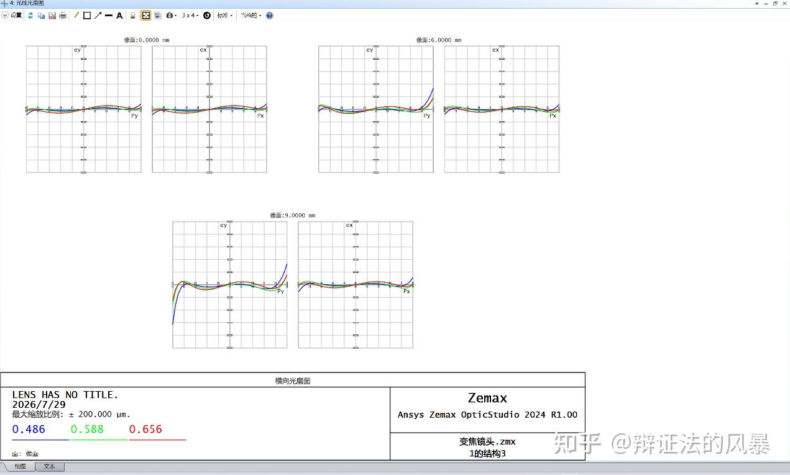

*图 12-10 30 mm 焦段光线光扇图*

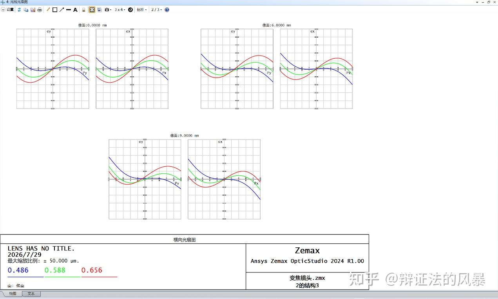

*图 12-11 60 mm 焦段光线光扇图*

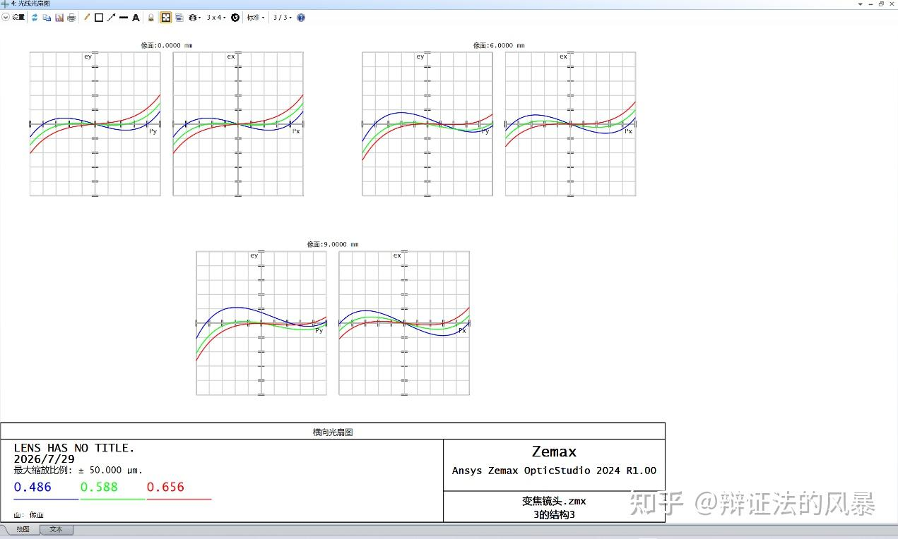

*图 12-12 90 mm 焦段光线光扇图*

**读图**：

* 中心视场（0 mm）的曲线始终平直 → 轴上像差控制良好；
* 边缘视场随焦段变化明显：30 mm 焦段 9 mm 视场的曲线在孔径边缘上翘（高阶像差）；90 mm 焦段边缘视场最差；
* 结论：**轴外像差（尤其长焦端）是全焦段像质的主要瓶颈**，后续优化应重点针对它。

### 12.5 对照要求逐项自查

设计做完不算完，**逐条对照要求表**才算完：

| 检查项 | 怎么查 | 结果 |
| --- | --- | --- |
| EFFL = 30 / 60 / 90 mm | 状态栏切换组态逐个核对（图 11-6） | ✅ 达成 |
| 后工作距 ≥ 25 mm | 镜头数据编辑器里看像面前一段的厚度，逐组态核对 | 需逐个组态确认 |
| 机械总长 ≤ 150 mm | 状态栏 TOTR | ⚠️ 约 150 mm，贴线，建议留余量 |
| 玻璃/空气厚度约束 | 优化向导的边界操作数自动保证，数值异常时复查 | ✅ 达成 |
| RMS < 2×艾里半径 | 点列图读数对比（见 12.1） | ⚠️ 90 mm 达成；30/60 mm 未达，原因为几何像差主导 |

> 设计报告中”未达标项”不是扣分项——**能说清原因**（变焦共用镜组、像差折中、总体长度受限）才是设计能力的体现。

### 13. 小结

走完这一遍，你已经掌握了 Zemax 设计的完整骨架：

> **建初始结构 → 定三件套（孔径/视场/波长）→ 设变量 → 写评价函数 → 优化 → 像质分析 → 对照要求自查**

变焦镜头的特殊之处只有一条：**用多重结构编辑器，让空气间隔随组态变化**；其余流程与普通镜头完全一致。

本教程到此为止，但真实项目一般还有两步（不在本文范围）：**公差分析**（评估加工误差的影响）和**导出 CAD 交给 Solidworks 做机械结构设计**。

---

---

## 附录

### 附录 A 本项目用到的操作数

本篇用到的几个操作数，单独说明如下：

| 操作数 | 在哪里用 | 用法要点 |
| --- | --- | --- |
| THIC | 多重结构编辑器 | 控制某个面的厚度随组态变化；本项目控制面 3、4、7、10 |
| CONF | 评价函数编辑器 | 划分组态；作用范围到下一个 CONF 为止 |
| EFFL | 评价函数编辑器 | 控制焦距；多组态时每个组态各写一条，目标 30 / 60 / 90 |
| TOTR | 评价函数编辑器 | 控制总长（第一面到像面） |
| OPLT | 评价函数编辑器 | 把目标从”等于”改成”小于”，常与 TOTR 搭配 |
| MNCA / MXCA、MNCG / MXCG | 评价函数编辑器 | 优化向导按厚度边界自动生成的曲率、玻璃厚度范围约束 |

### 附录 B 避坑清单与实用小技巧

**效率技巧**：

* **善用 Ctrl+Z**：Zemax 支持撤销，改错了不要慌，直接撤销；
* **Insert 键**：光标停在镜头数据编辑器的某行时按下，即可在此处**插入一个新面**；
* **Delete 键**：删除光标所在的面；
* **每完成一个阶段就”另存为”**：文件名带编号或日期，随时能回退到上一个稳定版本；
* 养成看**状态栏**的习惯：EFFL、ENPD、TOTR 实时可见，很多问题一眼就能发现。

**优化避坑**：

* ⚠️ **一步一步优化，不要一次加太多参数/变量**——这是全篇最重要的一条；
* 推荐顺序：先优化像差最敏感的曲率半径 → 整体曲率半径 → 空气间隔 → 透镜厚度 → 最后考虑材料；
* **边界约束要在优化前设好**（厚度、总长），否则优化器会”钻空子”，给出无法加工的结果；
* 多重组态下**别忘统一口径**（Maximum 解），否则你”优化好”的其实是三个不同的镜头；
* 优化卡住不动时：调一调权重、减掉一些变量，或换个算法重新开始；
* 每轮优化后看三个地方：评价函数值、镜头数据有无异常数值、点列图/MTF 是否真的变好了。

**参数设置避坑**：

* 厚度是”**到下一个面的距离**“，别和透镜厚度混淆；
* 视场一般只在 **y** 方向填值，x 保持 0；
* 波长记得设置**主波长**（通常取 d 光）；
* 打开 3D 布局图时把 **Y 偏移**设成正值（如 60 mm），多组态才不会重叠在一起。

### 附录 C 参考资料

* Zemax 操作数手册（软件自带帮助 / 在线文档）
* 李晓彤, 岑兆丰. 几何光学·像差·光学设计. 浙江大学出版社.
* 变焦与无焦系统基础及操作参考：

+ <https://www.optkt.com/fa/356/1>
+ <https://en.wikipedia.org/wiki/Beam_expander>
+ <https://en.wikipedia.org/wiki/Afocal_system>

---

原文链接：[查看知乎原文](https://zhuanlan.zhihu.com/p/2089739625048945495)
